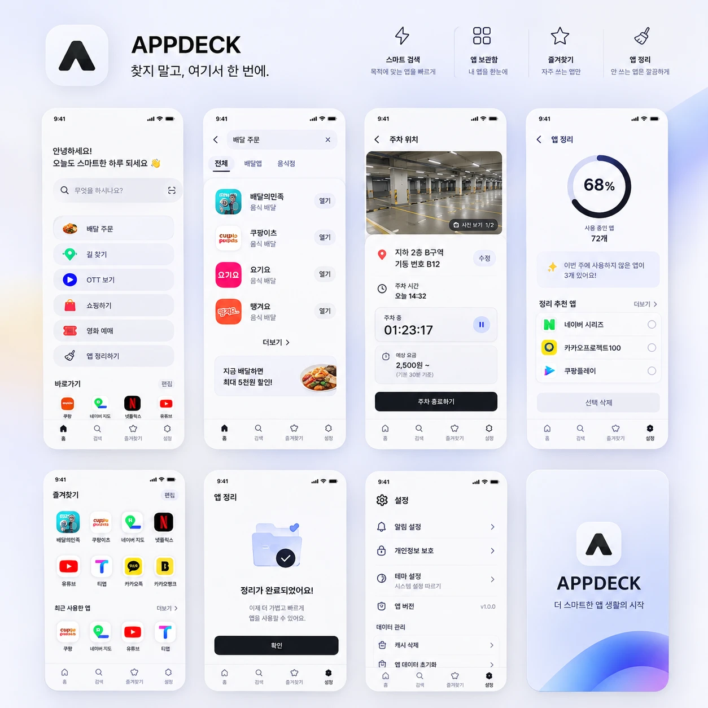

# APPDECK (앱덱)

> **찾지 말고, 여기서 한 번에.**
> 흩어진 앱을 한곳에서 찾고 바로 실행하는 나만의 앱 허브



휴대폰에 설치된 앱을 모아 **목적별 검색(배달 주문·길 찾기·OTT·쇼핑·영화 예매)**, **카테고리 분류**, **즐겨찾기**, **앱 정리**를 제공한다.
기기에 실제로 설치(또는 직접 등록)된 앱만 보여 주며, 앱 목록은 기기 밖으로 나가지 않는다.

## 지원 플랫폼 차이

| | Android | iOS | Web |
|---|---|---|---|
| 설치 앱 자동 조회 | ✅ (Development Build, 동의 후) | ❌ OS가 허용하지 않음 → **직접 등록** | 화면 확인용 가상 데이터 |
| 앱 실행 | ✅ | 등록한 링크로 실행 | ❌ |
| 사용 기록(선택) | ✅ 기본 OFF | ❌ | ❌ |

- **iOS에서는 설치된 앱 전체를 자동으로 검색할 수 없다.** 사용자가 앱을 직접 등록하고, 설치 여부는 "확인 불가"로 표시한다.
- Expo Go에는 앱 목록 네이티브 모듈이 없다. Android 기능은 Development Build에서 동작한다.

## 주요 화면 (레퍼런스 디자인 8종)
1. **홈** — 인사말, 검색창, 목적 바로가기 6종, 바로가기(즐겨찾기)
2. **목적 검색 결과** — 전체/세부 카테고리 탭, 앱 행 + "열기", 더보기, 하단 안내 카드
3. **주차 위치** — 사진, 층/구역, 주차 시각, 경과 타이머(일시정지), 예상 요금, 주차 종료
4. **앱 정리** — 정리 비율 링, 안내 카드, 정리 후보 체크 목록, 선택 정리
5. **즐겨찾기** — 4열 그리드(편집: 해제·순서 이동), 최근 앱덱에서 실행한 앱
6. **정리 완료**
7. **설정** — 앱 목록 설정, 개인정보 보호, 테마(시스템/라이트/다크), 사용 기록, 버전, 캐시 삭제, 데이터 내보내기, 초기화
8. **브랜드 인트로** — APPDECK 로고 + 블루 웨이브

추가: 검색 탭(앱 보관함·카테고리·정렬), 앱 상세(분류 변경·별칭·숨김·정리 후보·시스템 앱 정보), 수동 등록, 온보딩(앱 목록 확인 고지·동의).

## 기술 스택
Expo SDK 58 · React Native 0.88 · React 19.3 · Expo Router · TypeScript strict · expo-sqlite · Kotlin Expo Module · Jest(jest-expo)

아키텍처: [docs/ARCHITECTURE.md](docs/ARCHITECTURE.md) · 설계 결정: [docs/DECISIONS.md](docs/DECISIONS.md)

## 실행 방법

```bash
npm install
npm run web          # 웹 미리보기 (가상 데이터)

# Android APK (권장: EAS 클라우드 빌드, 프로젝트 @lcm2/appdeck)
npx eas-cli build -p android --profile preview      # 설치용 APK
npx eas-cli build -p android --profile production   # 스토어용 AAB

# 로컬 빌드 (ASCII 짧은 경로 + Windows 긴 경로 지원 필요, docs/DECISIONS.md ADR-009)
npx expo prebuild --platform android
npm run android:debug    # scripts/android-build.ps1 assembleDebug
```

## Android 권한과 동의
- `QUERY_ALL_PACKAGES`: 설치 앱 검색·분류·실행(핵심 기능). 첫 조회 전 온보딩에서 고지하고 **동의한 경우에만** 조회한다. 거부하면 직접 등록한 앱만 관리한다. Play 정책 검토: [docs/PLAY_POLICY_ELIGIBILITY.md](docs/PLAY_POLICY_ELIGIBILITY.md)
- `PACKAGE_USAGE_STATS`(선택, 기본 OFF): 설정 > 사용 기록에서 켜고 시스템 설정에서 직접 허용해야 한다.
- 사진: 주차 메모에 시스템 사진 선택기로 고른 사진만 사용. 위치·카메라 권한 없음.
- 다른 앱을 삭제·강제 종료하지 않는다(`REQUEST_DELETE_PACKAGES` 차단).

## 데이터 저장과 네트워크
- 모든 데이터는 기기 로컬 SQLite(웹 미리보기는 localStorage)에만 저장된다. 상세: [docs/PRIVACY.md](docs/PRIVACY.md)
- 서버·로그인·광고 SDK·분석 SDK·원격 AI **없음**.

## 테스트

```bash
npm test             # Jest 45개
npm run typecheck
npm run lint
npm run doctor
```

최근 결과와 미검증 항목: [docs/TESTING.md](docs/TESTING.md)

## 미검증 / 남은 작업
- Android 실기기 동작 검증 (APK는 EAS로 빌드 완료, 설치 앱 조회·실행·사용 기록은 기기에서 미확인)
- iOS 실행 검증
- 사용자 컬렉션(폴더), 백업 가져오기
- Play Console 권한 선언, Data safety, 개인정보 처리방침 URL, 상표 검색

## 라이선스
코드: 프로젝트 소유자 · 폰트: Pretendard (OFL 1.1) — [docs/LICENSES_AND_COPYRIGHT.md](docs/LICENSES_AND_COPYRIGHT.md)

---

## Work Log

### 2026-11-24 — Android 빌드 환경 · EAS APK
- 빌드 도구 설치: Microsoft OpenJDK 17(포터블, `C:\Android\jdk-17`), Android SDK(`C:\Android\Sdk`: platform-tools, platforms;android-37.0, build-tools 37.0.0, NDK 27.1, CMake 3.22.1), 공식 체크섬 확인
- 로컬 Gradle 빌드 시도 → 한글 경로·Windows 260자 경로 제한으로 실패 (원인과 우회 방법을 docs/TESTING.md, ADR-009에 기록)
- `react-native-gesture-handler` 자동 링크 제외(미사용), `scripts/android-build.ps1`에 CMake 객체 경로 축약 옵션 추가
- EAS 프로젝트 `@lcm2/appdeck` 연결, `eas.json` preview(APK)/production(AAB) 프로필, EAS 관리 서명 키
- **EAS preview 빌드 성공** → `appdeck-v0.1.0-preview.apk` (Kotlin 모듈 컴파일 통과, `QUERY_ALL_PACKAGES` 매니페스트 병합 확인)
- 실기기 검증은 사용자가 별도로 진행 예정

### 2026-11-24 — v0.1.0 MVP 초기 구현
- 기존 저장소(GudoPick·MoodMix·CutPick) 구조 분석 → Expo SDK 58 + `src/app` 라우팅 + domain/features/infrastructure/platform 분리 채택
- 개선: Nitro 대신 **Expo Modules API(Kotlin)** 로 앱 목록 모듈 단순화, 포트/어댑터로 Android·iOS·Web 분기 통일, 스캔 병합을 순수 함수(`mergeScan`)로 분리
- Android Kotlin 모듈: 런처 앱 조회, 아이콘 PNG 캐시(업데이트 시 무효화·삭제 앱 정리), 앱 실행/실패 사유, 앱 정보 화면, UsageStats(선택)
- 로컬 분류기(패키지·이름 규칙, 최장 일치) + 목적 검색(12개 목적, 초성·조사 처리·별칭)
- SQLite 마이그레이션(apps, app_aliases, app_launch_history, app_settings, parking_sessions)
- 레퍼런스 디자인 8개 화면 + 검색 탭·앱 상세·수동 등록·온보딩·개인정보·앱 목록 설정·사용 기록 화면
- 디자인 레퍼런스에서 목적 아이콘 7종 추출(`scripts/extract-reference-icons.mjs`), 라인 아이콘·브랜드 마크·일러스트 SVG 제작, 앱 아이콘/스플래시 생성(`scripts/generate-app-icons.mjs`)
- 라이트/다크 테마, 접근성 라벨
- 검증: tsc 0 · lint 0 · expo-doctor 20/20 · Jest 45/45 · 웹 미리보기 화면 확인 (Android/iOS 기기 미검증)
