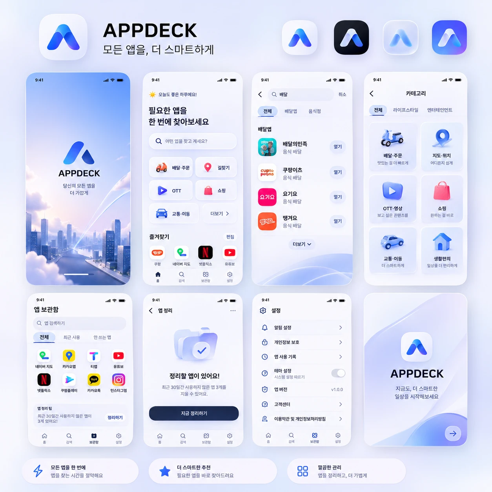

# APPDECK (앱덱)

> **모든 앱을, 더 스마트하게.**
> 흩어진 앱을 한곳에서 찾고 바로 실행하는 나만의 앱 허브



휴대폰에 설치된 앱을 모아 **목적별 검색(배달·주문·길찾기·OTT·쇼핑·교통·여행 등)**, **20개 카테고리 자동 분류**, **즐겨찾기**, **앱 보관함**, **앱 정리**를 제공한다.
기기에 실제로 설치(또는 직접 등록)된 앱만 보여 주며, 앱 목록은 기기 밖으로 나가지 않는다.

## 지원 플랫폼 차이

| | Android | iOS | Web |
|---|---|---|---|
| 설치 앱 자동 조회 | ✅ (Development Build, 동의 후) | ❌ OS가 허용하지 않음 → **직접 등록** | 화면 확인용 가상 데이터 |
| 앱 실행 | ✅ | 등록한 링크로 실행 | ❌ |
| 사용 기록(선택) | ✅ 기본 OFF | ❌ | ❌ |

- **iOS에서는 설치된 앱 전체를 자동으로 검색할 수 없다.** 사용자가 앱을 직접 등록하고, 설치 여부는 "확인 불가"로 표시한다.
- Expo Go에는 앱 목록 네이티브 모듈이 없다. Android 기능은 Development Build에서 동작한다.

## 주요 화면 (디자인 레퍼런스 v2)
하단 탭: **홈 · 검색 · 보관함 · 설정**

1. **스플래시** — 하늘 그라데이션 + 도시 일러스트 + 로고 "당신의 모든 앱을 더 가깝게"
2. **홈** — "오늘도 좋은 하루에요!", "필요한 앱을 한 번에 찾아보세요", 검색창, 빠른 실행 카드(배달·주문/길찾기/OTT/쇼핑/교통·이동/더보기), 즐겨찾기
3. **검색 결과** — 검색창 + 취소, 알약 탭(전체/배달앱/음식점…), 분류별 섹션, "열기", 더보기, 하단 물결
4. **카테고리** — 전체/라이프스타일/엔터테인먼트/이동·여행/소통·도구 탭, 3D 아이콘 카드 2열
5. **앱 보관함** — 앱 검색, 전체/최근 사용/안 쓰는 앱, 4열 그리드, 앱 정리 팁
6. **앱 정리** — 폴더 일러스트, "정리할 앱이 있어요!", 지금 정리하기 → 정리할 앱 고르기 → 정리 완료
7. **설정** — 알림 설정, 개인정보 보호, 앱 사용 기록, 테마 설정(시스템 따르기 토글), 앱 버전, 고객센터, 이용약관 및 개인정보처리방침 + 앱 관리·데이터 관리
8. **브랜드 카드(온보딩)** — "지금도, 더 스마트한 일상을 시작해보세요" → 기능 소개 + 앱 목록 확인 동의

추가: 앱 상세(분류 변경·별칭·숨김·정리 후보·시스템 앱 정보), 즐겨찾기 편집, 주차 위치 메모, 수동 등록.

## 카테고리 (20개, 로컬 규칙 자동 분류 · 카테고리 화면에서 앱 넣기/빼기 가능)
배달·주문, 음식점·카페, 지도·위치, 교통·이동, **여행·숙박**(코레일·SRT·고속/시외버스·항공·여기어때·야놀자 등), OTT·영상, 영화·공연, 음악·오디오, **게임**, 뉴스·웹툰·책, 쇼핑, 금융·결제, **공과금·세금**(홈택스·손택스·정부24·한전·건강보험·관리비 등), 생활편의, 건강·운동, **메신저·SNS**(문자/SMS 포함), 업무·생산성, 교육·학습, 사진·카메라, **유틸리티**(계산기·파일·QR·번역·브라우저 등), 기타

## 기술 스택
Expo SDK 58 · React Native 0.88 · React 19.3 · Expo Router · TypeScript strict · expo-sqlite · Kotlin Expo Module · Jest(jest-expo)

아키텍처: [docs/ARCHITECTURE.md](docs/ARCHITECTURE.md) · 설계 결정: [docs/DECISIONS.md](docs/DECISIONS.md)

## 실행 방법

```bash
npm install
npm run web          # 웹 미리보기 (가상 데이터)

# Android APK (권장: EAS 클라우드 빌드, 프로젝트 @lcm2/appdeck)
npx eas-cli build -p android --profile preview      # 설치용 APK
npx eas-cli build -p android --profile production   # 스토어용 AAB

# 로컬 빌드 (ASCII 짧은 경로 + Windows 긴 경로 지원 필요, docs/DECISIONS.md ADR-009)
npx expo prebuild --platform android
npm run android:debug    # scripts/android-build.ps1 assembleDebug
```

## Android 권한과 동의
- `QUERY_ALL_PACKAGES`: 설치 앱 검색·분류·실행(핵심 기능). 첫 조회 전 온보딩에서 고지하고 **동의한 경우에만** 조회한다. 거부하면 직접 등록한 앱만 관리한다. Play 정책 검토: [docs/PLAY_POLICY_ELIGIBILITY.md](docs/PLAY_POLICY_ELIGIBILITY.md)
- `PACKAGE_USAGE_STATS`(선택, 기본 OFF): 설정 > 사용 기록에서 켜고 시스템 설정에서 직접 허용해야 한다.
- 사진: 주차 메모에 시스템 사진 선택기로 고른 사진만 사용. 위치·카메라 권한 없음.
- 다른 앱을 삭제·강제 종료하지 않는다(`REQUEST_DELETE_PACKAGES` 차단).

## 데이터 저장과 네트워크
- 모든 데이터는 기기 로컬 SQLite(웹 미리보기는 localStorage)에만 저장된다. 상세: [docs/PRIVACY.md](docs/PRIVACY.md)
- 서버·로그인·광고 SDK·분석 SDK·원격 AI **없음**.

## 테스트

```bash
npm test             # Jest 55개
npm run typecheck
npm run lint
npm run doctor
```

최근 결과와 미검증 항목: [docs/TESTING.md](docs/TESTING.md)

## 미검증 / 남은 작업
- Android 실기기 동작 검증 (APK는 EAS로 빌드 완료, 설치 앱 조회·실행·사용 기록은 기기에서 미확인)
- iOS 실행 검증
- 사용자 컬렉션(폴더), 백업 가져오기
- Play Console 권한 선언, Data safety, 개인정보 처리방침 URL, 상표 검색

## 라이선스
코드: 프로젝트 소유자 · 폰트: Pretendard (OFL 1.1) — [docs/LICENSES_AND_COPYRIGHT.md](docs/LICENSES_AND_COPYRIGHT.md)

---

## Work Log

### 2026-11-25 — 카테고리 직접 편집 · 분류 오류 수정
- **카테고리 편집 모드**: 카테고리를 열고 `편집`을 누르면 ① `이 카테고리에 앱 넣기`(다른 카테고리 앱을 여러 개 골라 옮기기) ② 앱마다 `빼기`(옮길 카테고리 선택, 직접 넣은 앱은 `자동 분류로 되돌리기` 가능). 직접 바꾼 분류는 앱 목록을 새로 불러와도 유지
- 분류 오류 수정: `subway`가 교통으로 잡히던 문제 → 써브웨이(샌드위치 브랜드)는 음식점·카페, 지하철 앱은 `jihachul`·`seoulmetro` 등 구체적인 패턴으로 교통 분류 (규칙 v3)
- 다른 단어와 겹치던 짧은 패턴 정리(`cake`·`speak`·`santa`·`ebs`·`paris`·`compose`)
- 테스트 58개 통과, 웹 미리보기로 넣기·빼기·되돌리기 확인 (APK에는 아직 미반영)

### 2026-11-25 — 디자인 v2 전면 적용 · 카테고리 확장
- 새 디자인 레퍼런스(`assets/reference/appdeck-design-reference-v2.webp`) 기준으로 전체 화면 리디자인: 라벤더 화이트 그라데이션 배경, 반투명 글래스 카드, 네이비 텍스트, 알약형 탭, 하단 탭 `홈·검색·보관함·설정`
- 레퍼런스에서 추출: 카테고리 3D 아이콘 6종, 홈 빠른 실행 아이콘 5종, 해 아이콘, 앱 정리 폴더 일러스트, 스플래시 도시 일러스트 (`scripts/extract-reference-icons.mjs`)
- 새 로고(블루→바이올렛 Λ) SVG 재현 + 앱 아이콘·스플래시·파비콘 재생성
- 레퍼런스에 없는 카테고리 아이콘 14종은 같은 광택 3D 스타일 SVG로 제작 (여행·메신저·게임·금융·공과금·카페·영화·음악·읽을거리·건강·업무·교육·사진·유틸)
- 새 화면: 카테고리(그룹 탭), 앱 보관함(최근 사용/안 쓰는 앱/정리 팁), 앱 정리 안내 → 고르기 → 완료, 브랜드 카드 온보딩
- 카테고리 15 → 20개: 여행·숙박(기차·버스·항공·숙소 예약), 공과금·세금, 뉴스·웹툰·책, 건강·운동, 교육·학습 추가 / 메신저에 문자(SMS) 포함 / 시스템 도구 → 유틸리티 / 분류 규칙 v2(패키지·이름 패턴 대폭 확장, 최장 일치)
- 목적 검색 19종(교통·이동, 여행·숙박, 공과금·세금, 게임, 뉴스·웹툰, 건강, 생활, 공부, 유틸리티 추가)
- 테스트 55개 통과(카테고리 v2 10개 추가), 웹 미리보기로 전 화면 확인
- **EAS preview APK 재빌드** → `appdeck-v0.1.0-design-v2.apk` (빌드 `5ec7b441`, 새 디자인·카테고리 포함 확인). 실기기 검증은 사용자가 별도로 진행

### 2026-11-24 — Android 빌드 환경 · EAS APK
- 빌드 도구 설치: Microsoft OpenJDK 17(포터블, `C:\Android\jdk-17`), Android SDK(`C:\Android\Sdk`: platform-tools, platforms;android-37.0, build-tools 37.0.0, NDK 27.1, CMake 3.22.1), 공식 체크섬 확인
- 로컬 Gradle 빌드 시도 → 한글 경로·Windows 260자 경로 제한으로 실패 (원인과 우회 방법을 docs/TESTING.md, ADR-009에 기록)
- `react-native-gesture-handler` 자동 링크 제외(미사용), `scripts/android-build.ps1`에 CMake 객체 경로 축약 옵션 추가
- EAS 프로젝트 `@lcm2/appdeck` 연결, `eas.json` preview(APK)/production(AAB) 프로필, EAS 관리 서명 키
- **EAS preview 빌드 성공** → `appdeck-v0.1.0-preview.apk` (Kotlin 모듈 컴파일 통과, `QUERY_ALL_PACKAGES` 매니페스트 병합 확인)
- 실기기 검증은 사용자가 별도로 진행 예정

### 2026-11-24 — v0.1.0 MVP 초기 구현
- 기존 저장소(GudoPick·MoodMix·CutPick) 구조 분석 → Expo SDK 58 + `src/app` 라우팅 + domain/features/infrastructure/platform 분리 채택
- 개선: Nitro 대신 **Expo Modules API(Kotlin)** 로 앱 목록 모듈 단순화, 포트/어댑터로 Android·iOS·Web 분기 통일, 스캔 병합을 순수 함수(`mergeScan`)로 분리
- Android Kotlin 모듈: 런처 앱 조회, 아이콘 PNG 캐시(업데이트 시 무효화·삭제 앱 정리), 앱 실행/실패 사유, 앱 정보 화면, UsageStats(선택)
- 로컬 분류기(패키지·이름 규칙, 최장 일치) + 목적 검색(12개 목적, 초성·조사 처리·별칭)
- SQLite 마이그레이션(apps, app_aliases, app_launch_history, app_settings, parking_sessions)
- 레퍼런스 디자인 8개 화면 + 검색 탭·앱 상세·수동 등록·온보딩·개인정보·앱 목록 설정·사용 기록 화면
- 디자인 레퍼런스에서 목적 아이콘 7종 추출(`scripts/extract-reference-icons.mjs`), 라인 아이콘·브랜드 마크·일러스트 SVG 제작, 앱 아이콘/스플래시 생성(`scripts/generate-app-icons.mjs`)
- 라이트/다크 테마, 접근성 라벨
- 검증: tsc 0 · lint 0 · expo-doctor 20/20 · Jest 45/45 · 웹 미리보기 화면 확인 (Android/iOS 기기 미검증)
